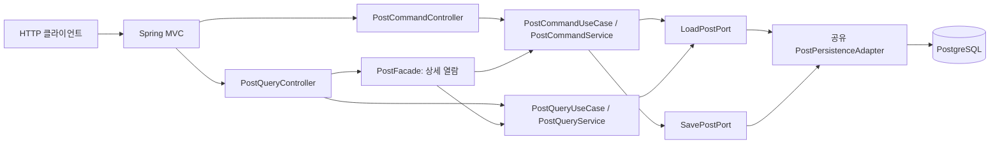

# 아키텍처와 설계 이유

Spring Boot가 HTTP 서버를 시작하고 컴포넌트 스캔과 생성자 주입으로 게시글 객체를 연결합니다.
웹 클라이언트의 요청을 Controller → Service → Persistence Adapter → PostgreSQL 순서로 처리합니다.
Command/Query 서비스와 포트로 책임을 분리하고, 엔티티의 변경 감지와 응답 DTO 변환을 사용합니다.
실행 방법과 요청 예시는 [서버 실행 및 검증](#서버-실행-및-검증)을 참고하세요.

## 어노테이션과 객체 연결

| 클래스 | 어노테이션 | 책임 |
| --- | --- | --- |
| `Main` | `@SpringBootApplication` | 서버 시작과 org.sopt 하위 컴포넌트 스캔 |
| `PostCommandController` | `@RestController`, `@RequestMapping` | 작성·수정·삭제 HTTP 요청 |
| `PostQueryController` | `@RestController`, `@RequestMapping` | 목록·단건 조회 HTTP 요청 |
| `PostCommandService` | `@Service`, `@Transactional` | 생성·수정·삭제·조회수 증가의 쓰기 작업 |
| `PostQueryService` | `@Service`, `@Transactional(readOnly = true)` | 목록·단건 순수 조회 |
| `PostFacade` | `@Service`, 상세 메서드의 `@Transactional` | 조회수 증가와 상세 조회를 조합하는 전체 트랜잭션 |
| `PostPersistenceAdapter` | `@Component`, `@RequiredArgsConstructor` | LoadPostPort·SavePostPort의 공유 JPA 구현 |
| `GlobalExceptionHandler` | `@RestControllerAdvice`, `@ExceptionHandler` | 도메인·MVC 예외를 공통 HTTP 실패 응답으로 변환 |
| `ApiErrorController` | `@RestController` | 서블릿 오류 디스패치를 공통 JSON 응답으로 변환 |

PostPersistenceAdapter는 Lombok의 @RequiredArgsConstructor가 final 필드의 생성자를 생성합니다.
생성자가 하나인 컴포넌트는 생성자로 의존성을 주입받습니다.
서비스는 구체 저장소 대신 포트 인터페이스에 의존합니다. Spring이 같은 저장소 Bean을
LoadPostPort·SavePostPort에 주입하므로 Command의 변경 결과와 상세 조회수 증가를 같은 DB에서 처리합니다.
포트 인터페이스, 도메인, DTO는 Spring Bean으로 등록하지 않습니다.
운영 코드에는 수동 객체 조립 팩토리가 없습니다. 컨트롤러 단위 테스트는 테스트 내부에서 독립된 저장소와 서비스를 구성합니다.



## HTTP 요청과 공통 응답

| 요청 | 매핑 | 성공 상태 |
| --- | --- | --- |
| `POST /posts` | `@PostMapping` | 201 |
| `GET /posts` | `@GetMapping` | 200 |
| `GET /posts/{id}` | `@GetMapping("/{id}")` | 200 |
| `HEAD /posts/{id}` | `@RequestMapping(method = HEAD)` | 200 |
| `PUT /posts/{id}` | `@PutMapping("/{id}")` | 200 |
| `DELETE /posts/{id}` | `@DeleteMapping("/{id}")` | 200 |

JSON 본문은 `@RequestBody`로 요청 record에 바인딩한 뒤 생성·수정 요청에 `@Valid`를 적용합니다. 경로 ID는
`@PathVariable("id")`로 받습니다. 수정은 제목·본문을 모두 전달하는 기존 계약을 따릅니다.
생성·수정·삭제는 성공 메시지와 null 데이터를 반환합니다. 삭제도 응답 본문을 유지하므로 200입니다.

게시글 컨트롤러는 `produces = application/json`으로 응답 형식을 선언합니다.
지원하지 않는 Accept는 컨트롤러 실행 전에 406으로 거부하므로 생성·수정·삭제·조회수 증가가 일어나지 않습니다.
Accept 생략, `application/json`, 호환되는 와일드카드 요청은 기존처럼 처리합니다.
응답 형식 정책은 게시글 웹 어댑터에 두며, 다른 도메인은 자신의 API 계약에 맞게 선언합니다.

`BaseResponse<T>`는 기존 `success`, `code`, `message`, `data`에 `violations` 배열을 추가합니다.
성공·일반 실패에는 빈 배열을, 입력 검증 실패에는 필드별 오류 목록을 반환합니다.
성공 코드는 SUCCESS이며 실패 응답의 data는 null입니다.
컨트롤러는 성공 응답만 만들고 예외를 Spring MVC로 전파합니다.

성공 응답은 `BaseResponse.success(data, message)`를 사용합니다. 별도의 SuccessCode Enum은 도입하지 않았으며,
생성의 HTTP 201은 컨트롤러의 `@ResponseStatus`, 나머지 성공의 HTTP 200은 MVC 기본 상태로 결정합니다.
현재 BaseResponse 생성자는 성공 코드를 SUCCESS로 제한하므로 도메인별 성공 코드를 바로 전달할 수 없습니다.

| 실패 | HTTP 상태 | 응답 코드 |
| --- | --- | --- |
| HTTP 필수값 검증 실패 | 400 | VALIDATION_FAILED + violations |
| 도메인 검증 실패 | 400 | INVALID_TITLE, INVALID_CONTENT, INVALID_CATEGORY, INVALID_AUTHOR |
| 빈 본문·잘못된 JSON·알 수 없는 카테고리·잘못된 ID 형식 | 400 | INVALID_REQUEST |
| 없는 게시글 조회·수정·삭제 | 404 | POST_NOT_FOUND |
| 없는 경로·정적 리소스 | 404 | RESOURCE_NOT_FOUND |
| 지원하지 않는 HTTP 메서드 | 405 | METHOD_NOT_ALLOWED |
| 지원하지 않는 Accept | 406 | NOT_ACCEPTABLE |
| 지원하지 않는 Content-Type | 415 | UNSUPPORTED_MEDIA_TYPE |
| 예상하지 못한 Exception (checked 포함) | 500 | INTERNAL_SERVER_ERROR |

### 응답 계약과 확장 방법

`BaseResponse`는 불변 record이며 성공 여부·코드 조합, 실패 데이터, 빈 코드·메시지를 검증합니다.
`@JsonInclude(ALWAYS)`로 전역 Jackson의 null 생략 설정과 관계없이 다섯 필드를 유지합니다.
검증 목록은 방어적 복사로 불변 스냅샷을 보장하고 성공 응답에 오류 목록이 들어가는 것을 거부합니다.
클라이언트는 사람이 읽는 message 대신 안정적인 code로 오류를 구분합니다.
Enum 상수 이름과 공개 코드 문자열을 분리하여 내부 이름 변경이 API 계약 변경으로 이어지지 않게 합니다.

새 도메인의 오류 Enum은 `ErrorCode`를 구현하고 HTTP 상태·공개 코드·안전한 메시지를 선언합니다.
해당 오류를 `BaseException` 또는 그 하위 예외에 담아 던지면 전역 핸들러 수정 없이 처리됩니다.
현재는 작은 서버의 공통 오류 계약에서 Spring의 `HttpStatus`를 사용합니다. 도메인 오류도 이 계약을
참조하므로 HTTP/Spring 의존이 있습니다. HTTP 외 어댑터가 필요해지면 오류 분류와 웹 상태 매핑을 분리할 수 있습니다.
도메인별 코드 비교나 등록용 switch를 전역 핸들러에 추가하지 않습니다.

`GlobalExceptionHandler`는 `ResponseEntityExceptionHandler`를 확장합니다.
Spring이 분류하는 바인딩·검증·변환·라우팅 예외의 상태와 헤더를 보존합니다.
요청 본문 검증 실패는 `handleMethodArgumentNotValid`에서 오류 목록이 있는 BaseResponse를 만들고,
최종 응답 생성 단계에서는 이 본문을 유지합니다. 나머지 MVC 오류 본문은 공통 실패 응답으로 교체합니다.
405의 Allow, 429의 Retry-After 같은 헤더를 유지합니다.
406을 포함한 오류 응답은 Accept와 관계없이 `application/json`으로 반환하는 API 정책입니다.
새 표준 HTTP 오류가 추가돼도 상태는 보존하며, 미등록 4xx는 INVALID_REQUEST,
미등록 5xx는 INTERNAL_SERVER_ERROR의 안전한 메시지를 사용합니다.

`ApiErrorController`는 필터 예외나 `sendError()`로 발생한 서블릿 ERROR 디스패치를 처리합니다.
Boot 기본 HTML/Map 대신 같은 응답 객체를 사용하고 서버의 오류 상태 속성만 읽습니다.
원본 오류 메시지·스택·쿼리·요청 본문은 응답에 포함하지 않습니다.
예상하지 못한 예외와 명시적인 5xx는 SLF4J로 원인을 기록하고, 일반 4xx는 오류 스택을 남기지 않습니다.

### HTTP 입력 검증

`spring-boot-starter-validation`과 요청 DTO의 `@NotBlank`·`@NotNull`, 생성·수정 컨트롤러의 `@Valid`로
HTTP 입력의 필수값을 검사합니다. 여러 필드 오류를 모아 `VALIDATION_FAILED`로 반환하며 유스케이스 호출을 막습니다.
생성 요청은 title·content·author에 NotBlank, category에 NotNull을 적용합니다.
수정 요청은 title·content에 NotBlank, 필수 version에 NotNull·PositiveOrZero를 적용합니다.
정수 필드로 보낸 소수는 Jackson에서 절삭하지 않고 INVALID_REQUEST로 거부합니다.
검증은 컨트롤러 호출 전에 실행됩니다. 따라서 없는 게시글을 수정하더라도 본문이 유효하지 않으면
게시글 조회의 404보다 입력 검증의 400을 먼저 반환합니다. 빈 JSON 객체 `{}`도 필수값 검증 대상이며,
빈 본문·JSON의 `null`·깨진 JSON은 역직렬화 또는 필수 본문 처리 단계의 INVALID_REQUEST입니다.
도메인의 검증도 유지해 HTTP를 거치지 않는 호출에서도 잘못된 게시글 생성·수정을 거부합니다.
제목·본문·작성자에 PostgreSQL 텍스트로 저장할 수 없는 NUL(U+0000)이 포함되면
도메인에서 거부하고 HTTP 400·NUL_CHARACTER_NOT_ALLOWED를 반환합니다. 검증 목록은 빈 배열입니다.
생성·수정에 같은 규칙을 적용하며 수정 거부 시 기존 제목·본문과 편집 버전은 유지합니다.
문자를 제거하거나 치환하지 않으며, 줄바꿈·탭·이모지와 문자 그대로의 `\u0000` 텍스트는 보존합니다.
길이 상한은 제목 200, 본문 10,000, 작성자 50이며 최대값까지 허용하고 초과 입력은 거부합니다.
`Post`의 길이 상수가 정책을 정의하고 도메인 검증과 요청 DTO의 `@Size`가 같은 상수를 사용합니다.
길이는 Java `String.length()`와 `@Size`에 맞춰 UTF-16 코드 단위로 계산합니다.
예를 들어 일반 한글은 1, 보충 문자 영역의 이모지는 2로 계산하며, 공백을 제거하거나 내용을 잘라 저장하지 않습니다.
생성·수정 모두 검증하며, 수정 검증 실패 시 제목·본문 전체를 보존합니다.
HTTP 외 호출에서도 초과 입력은 TITLE_TOO_LONG·CONTENT_TOO_LONG·AUTHOR_TOO_LONG으로 거부합니다.
길이 정책 변경은 게시글 도메인의 상수를 수정하고 경계값 테스트·문서를 함께 갱신합니다.
다른 도메인의 길이 정책은 해당 도메인에 둡니다.
DB의 TEXT 타입과 기존 데이터는 유지하므로 이 제한은 새 생성·수정 입력에 적용됩니다.
목록은 본문 전체를 계속 반환하며, 기존에 저장된 대형 본문의 응답 크기를 줄이지는 않습니다.

`RequestValidationErrors`는 BindingResult를 불변 `ValidationViolation(field, code, message)` 목록으로 변환합니다.
NotBlank·NotNull은 공개 코드 REQUIRED로, Size는 INVALID_LENGTH로 매핑합니다.
전역 변환기는 게시글 전용 길이 수치를 모르며 미등록 제약은 INVALID_VALUE와 안전한 공통 문구를 사용합니다.
필드 오류와 객체 전체 오류를 모두 포함하고, 객체 전체 오류의 field는 null입니다.
동일한 공개 오류는 중복 제거하고 field(null 우선)·code·message 순으로 정렬합니다.
클라이언트는 오류 발생 순서에 의존하지 않고 field/code를 사용해야 합니다.
검증 메시지로 오류 Enum을 역조회하거나 클래스패스를 스캔하지 않습니다.
원본 메시지·거부된 값·객체명·제약 구현명을 응답에 복사하지 않아 검증 엔진의 메시지에도 의존하지 않습니다.
새 제약에 구체 안내가 필요하면 이 변환기에 명시적인 공개 코드와 메시지를 추가합니다.

HTTP 필수값 검증 오류의 최상위 코드는 기존 INVALID_TITLE 등에서 VALIDATION_FAILED로 변경됩니다.
PostException의 기존 코드·메시지는 유지하므로 HTTP 외 도메인 검증이나 비즈니스 실패를 구분할 수 있습니다.
본문 역직렬화 실패(잘못된 JSON·잘못된 enum 값·빈 본문)는 검증 단계에 도달하지 못하므로
INVALID_REQUEST와 빈 목록을 반환합니다. 현재 적용 범위는 요청 본문이며, 경로 ID 형식 오류도 기존 처리를 유지합니다.

현재 JSON CRUD API는 컨트롤러 반환형에 `BaseResponse<T>`를 명시합니다.
자동 래핑은 이중 래핑 및 파일·스트림 응답과의 충돌을 피하기 위해 사용하지 않습니다.
새 JSON API도 같은 반환형과 성공 팩터리를 사용해야 합니다.
HEAD·자동 OPTIONS·204처럼 본문이 없거나 프로토콜 차원에서 처리하는 응답에는 봉투를 강제하지 않습니다.
이미 전송된 응답, 클라이언트 연결 종료, 서블릿 컨테이너에 도달하기 전 프록시 오류는
애플리케이션에서 새 JSON 본문으로 변환할 수 없습니다.
향후 Spring Security를 도입해 응답을 직접 작성한다면 별도 인증·인가 핸들러에도 이 계약을 적용해야 합니다.

### 구현 상태와 논의한 확장안

| 항목 | 현재 상태 |
| --- | --- |
| 응답 필드 | success·code·message·data·violations의 다섯 필드 |
| 성공 코드 | SUCCESS 고정, SuccessCode Enum 없음 |
| 오류 표현 | 공통 응답 객체 사용, 중첩 error 객체나 RFC 9457 ProblemDetail을 외부 응답으로 사용하지 않음 |
| 요청 추적 식별자 | requestId·traceId 생성 및 응답·로그 연동 미구현 |
| 입력 검증 | 생성·수정 요청 본문의 필수값 검증과 도메인 검증 |
| 객체 전체 검증 | 오류 변환과 테스트는 지원하지만 현재 DTO에 객체 전체 제약은 없음 |
| 인증·인가 | Spring Security 의존성·인증 기능·전용 실패 핸들러 미구현 |

GlobalErrorCode의 UNAUTHORIZED·FORBIDDEN·TOO_MANY_REQUESTS 등은 해당 상태의 공통 오류 표현입니다.
코드가 선언되어 있다는 것만으로 인증·인가나 요청 횟수 제한 기능이 제공되지는 않습니다.

## 도메인과 저장소

`Post`는 `@Entity`, `@Table(name = "posts")`로 직접 매핑한 JPA 엔티티입니다.
JPA의 protected 기본 생성자를 제공하며 필드를 final로 선언하지 않습니다.
Command 서비스는 조회와 수정·삭제를 하나의 `@Transactional` 안에서 수행합니다.
수정은 조회한 관리 엔티티의 `Post.update(title, content)`를 호출하고, 커밋 시 JPA 변경 감지로 DB에 반영합니다.
Post.update는 제목·본문을 모두 검증한 뒤 필드를 바꾸므로 검증 실패 시 부분 변경이 발생하지 않습니다.
작성 시각·카테고리·작성자는 수정 후에도 유지됩니다.
조회한 Post 엔티티는 불변 스냅샷이 아니며, 서비스 트랜잭션 안에서는 관리되는 객체입니다.
`PostResponse.from(Post)`와 `PostCategory`의 변환 메서드를 통해 DTO와 도메인을 연결합니다.
웹 어댑터가 만든 조회 응답 DTO와 목록은 엔티티와 분리되어 이후 변경·삭제로 바뀌지 않습니다.

`Post`가 테이블 매핑과 유효성 검증을 함께 담당하며, 별도 엔티티 변환은 없습니다. 카테고리는 문자열, 제목·본문·작성자는 TEXT로 저장합니다.
작성 시각은 기존 LocalDateTime 의미를 유지하며 DB의 마이크로초 정밀도에 맞춥니다.

`PostPersistenceAdapter`가 `PostRepository`를 사용합니다.
신규 Post의 ID는 null입니다. 신규 저장은 ID가 없는 객체만 허용하고 Spring Data JPA의 save를 호출합니다.
`@GeneratedValue(strategy = GenerationType.IDENTITY)`로 INSERT 시 DB가 ID를 생성합니다.
이미 ID가 있는 객체를 신규 저장 경로에 전달하면 거부해 기존 행을 덮어쓰지 않습니다.
수정·삭제는 서비스에서 대상을 조회하고, 없으면 POST_NOT_FOUND를 던집니다.
수정에는 별도 save 호출·수정 출력 포트·벌크 UPDATE 쿼리를 사용하지 않습니다.
삭제는 조회한 엔티티를 SavePostPort.delete에 전달하고 어댑터가 JpaRepository.delete를 호출합니다.
Command는 쓰기, Query는 순수 조회를 담당합니다. 두 흐름을 조합하는 상세 열람은 Facade의 쓰기 트랜잭션으로 묶습니다.
Facade에서 호출하는 Command·Query 서비스는 기본 REQUIRED 전파에 따라 같은 트랜잭션에 참여합니다.
Query 서비스의 readOnly 설정이 이미 시작한 Facade의 쓰기 트랜잭션을 읽기 전용으로 바꾸지는 않습니다.
저장소 호출은 진행 중인 서비스 트랜잭션에 참여합니다. 서비스 밖에서 Repository의 save/delete를 직접
호출하면 Spring Data의 해당 메서드 트랜잭션이 적용되지만, 이것이 조회·수정 전체를 대신하지는 않습니다.

ID는 PostgreSQL identity 컬럼이 자동 생성해 서버 재시작이나 다중 서버 실행에도
중복되지 않습니다. 별도의 ID 발급 포트·구현체·nextval 호출은 없습니다. 실패나 롤백 시에도 시퀀스 값이 소비될 수 있어 연속 번호는 보장하지 않습니다.
트랜잭션은 작업의 커밋·롤백을 묶고, 동시 수정은 요청의 예상 버전 검사와 JPA @Version으로 보호합니다.
사전 검사와 커밋 단계의 낙관적 잠금 충돌은 같은 HTTP 409·CONFLICT로 반환합니다.
오래된 편집 화면·커밋 경합·조회수와의 분리 및 배포 조건은 [편집 충돌 처리](post-edit-conflicts.md)를 참고하세요.
상세 조회는 조회수 UPDATE의 반영 행 수가 0이면 POST_NOT_FOUND를 반환합니다. 수정·삭제는 대상 조회로 존재 여부를 확인합니다.

스키마는 Flyway의 버전별 SQL로 관리하고 운영·테스트의 JPA는 ddl-auto=validate로 매핑을 검증합니다.
V1은 테이블 생성, V2는 조회수 컬럼, V3는 `(category, id)` 인덱스, V4는 편집 버전 추가를 담당합니다.
비밀번호는 환경변수로 설정합니다.
메모리 저장소는 src/test 아래에서 단위 테스트 대역으로만 사용합니다.
대역은 같은 엔티티 참조를 반환해 변경 결과를 관찰하며, JPA 트랜잭션·변경 감지·롤백은 실제 DB 통합 테스트로 검증합니다.
엔티티의 ID·필드 복원은 JPA에 맡기며, 수동 ID 생성자나 저장소 복원용 팩터리는 제공하지 않습니다.

## 목록 페이지네이션과 카테고리 조회

`GET /posts?page=0&size=20&category=QUESTION`으로 한 페이지를 조회합니다.
page는 0부터 시작하고 기본값은 0, size의 기본값은 20이며 1~100을 허용합니다.
숫자가 아닌 값과 int 범위 밖의 숫자, 알 수 없는 category는 HTTP 400과 INVALID_REQUEST입니다.
음수 page·허용 범위 밖 size·int 범위를 넘는 `page * size`는 INVALID_PAGINATION입니다.
JPA의 offset이 int이므로 곱셈은 long으로 검사하여 오버플로와 저장소 예외를 방지합니다.
생략하거나 빈 값으로 보낸 page·size는 기본값을 사용하고, category는 전체 분류를 조회합니다.

웹 어댑터는 외부 PostCategory를 도메인 Category로 변환하고,
`PostListQuery`가 HTTP 외 호출에서도 조회 범위를 검증합니다.
입력·출력 포트는 이 조회 조건을 공유하며 Spring Data 타입에 의존하지 않습니다.
`PostPersistenceAdapter`에서만 PageRequest로 변환합니다.
카테고리 조건 유무에 따라 저장소 메서드를 선택하고,
DB에서 WHERE → ORDER BY id ASC → OFFSET/LIMIT 순서로 처리합니다.
전체 데이터를 메모리에 올려 자르지 않으며 ID의 고유한 순서로 페이지 경계를 정합니다.
전체 조회는 PK, 카테고리 조회는 V3의 `(category, id)` 복합 인덱스를 활용할 수 있습니다.

기존 `data` 배열 계약을 유지하고 총 개수·총 페이지 수는 제공하지 않습니다.
요청한 페이지에 결과가 없으면 HTTP 200과 빈 배열을 반환합니다.
List를 반환하는 저장소 메서드를 사용하므로 총 개수를 위한 COUNT 쿼리는 실행하지 않습니다.
페이지네이션·필터 목록 조회 모두 조회수를 변경하지 않습니다.
`PostListingTest`는 기본값·경계·카테고리별 필터 적용 순서·빈 결과·잘못된 입력을 실제 H2 DB와 HTTP 계층에서 검증합니다.

앞으로 작성자 필터를 추가한다면 PostListQuery와 게시글 저장소의 검색 조건을 확장합니다.
조건 조합이 많아져 메서드가 반복되면 그때 Specification이나 전용 검색 저장소를 검토합니다.
회원 목록은 회원 도메인에 조회 조건을 두고, 실제로 공유되는 계약이 생길 때 공통화를 검토합니다.
현재 offset 방식은 깊은 페이지의 비용과 페이지 사이 삭제에 따른 결과 이동이 있습니다.
대량 데이터에서 이 문제가 중요해지면 ID 기반 커서 페이지네이션을 별도 계약으로 도입합니다.

## 조회수

조회 응답의 `viewCount`는 기존·신규 게시글 모두 0부터 시작합니다.
`GET /posts/{id}` 성공마다 1 증가하고 증가한 값을 반환하며 목록 조회는 값을 변경하지 않습니다.
같은 사용자의 반복 요청도 매번 집계합니다.

`HEAD /posts/{id}`는 명시적인 웹 매핑에서 순수 Query를 호출하므로 조회수를 증가시키지 않습니다.
GET과 같은 응답 표현을 구성하고 서블릿 컨테이너가 본문을 생략해 응답 헤더만 전송합니다.
없는 게시글은 404이며, 지원하지 않는 Accept는 406입니다. HTTP 메서드 구분은 웹 어댑터가 담당하고,
기존 Query 서비스와 Facade의 트랜잭션 책임은 유지합니다.
`PostHeadHttpTest`는 실제 내장 서버에서 반복 HEAD의 조회수 비증가, GET의 증가 유지,
404·406 응답과 본문 생략을 검증합니다.

HTTP 상세 조회는 `PostFacade.getPostDetail()`을 호출합니다. Facade는
`PostCommandUseCase.increaseViewCount()`로 DB에서 `view_count = view_count + 1`을 실행한 뒤
`PostQueryUseCase.getPost()`로 게시글을 읽습니다. Command는 `SavePostPort`, Query는 `LoadPostPort`만 사용합니다.
두 작업은 동일 트랜잭션이며 후속 조회에 실패하면 앞선 조회수 증가도 롤백됩니다.
내부에서 `PostQueryUseCase.getPost()`만 호출하면 조회수는 증가하지 않습니다.
동시 요청의 누락을 방지하기 위해 DB에서 원자적으로 증가시킵니다.
같은 게시글 행의 UPDATE부터 Facade 트랜잭션 커밋까지 DB의 행 잠금이 유지되어,
증가와 응답용 조회가 다른 요청의 동일 행 UPDATE와 순서대로 실행됩니다.
임계구역은 해당 게시글 행의 상세 열람 트랜잭션이며 다른 게시글의 조회는 같은 잠금으로 묶이지 않습니다.
애플리케이션 전체 synchronized 잠금이 없어 다중 서버에서도 같은 DB를 통해 조율됩니다.
생성은 DB identity가 ID 발급을 조율하고 각 INSERT는 독립된 트랜잭션으로 처리합니다.
현재 생성·상세 조회의 동시성 보장은 기존 구현을 유지하고 테스트로 보강했습니다.
`PostCreationConcurrencyTest`는 8개 작업자의 HTTP 생성 40건이 유실·ID 중복 없이 저장되는지 확인하고,
`PostViewCountTest`는 상세 열람 40건의 최종 조회수와 각 반환값이 정확히 1~40인지 확인합니다.
위 테스트는 H2 PostgreSQL 모드 기반입니다. 별도 `postgresTest`는 임시 PostgreSQL 18.2에서
동시 HTTP 생성·조회, 오래된 본문 수정과 조회수 증가의 교차 실행, 행별 잠금 범위와 롤백을 검증합니다.
운영 부하 수준의 처리량·잠금 대기는 측정하지 않습니다.
실행 방법과 검증 범위는 [PostgreSQL 통합 테스트](postgresql-tests.md)를 참고하세요.
벌크 UPDATE 전 `flushAutomatically = true`로 대기 중인 변경을 반영하고,
영속성 어댑터에서 `EntityManager.getReference()`로 대상 참조를 얻고,
해당 게시글만 `EntityManager.refresh()`로 다시 읽습니다.
참조를 얻을 때 미리 조회하지 않으므로 일반 상세 열람은 UPDATE 1회와 SELECT 1회로 처리합니다.
전체 영속성 컨텍스트를 비우지 않으므로, 같은 트랜잭션에서 이미 조회한 다른 엔티티와
대상 게시글 모두 이후 수정이 변경 감지로 저장됩니다.
`refresh()`는 대상의 메모리 값을 DB 값으로 덮어쓰므로 UPDATE 전 flush 순서를 유지해야 합니다.
현재는 게시글에 연관관계가 없으며, 향후 `CascadeType.REFRESH`를 추가하면 연관 엔티티까지
갱신 범위가 넓어지는지 함께 검토해야 합니다.
`view_count`는 `updatable = false`로 일반 엔티티 UPDATE에서 제외하므로,
오래된 엔티티로 제목·본문을 수정해도 다른 요청이 증가시킨 조회수를 덮어쓰지 않습니다.
제목·본문 자체의 동시 수정 충돌은 별도의 예상 버전 검사와 @Version으로 처리합니다.

`PostViewCountTest`는 HTTP 응답, 목록 조회의 비증가, 없는 게시글, 트랜잭션 롤백,
동시 상세 조회 40건 및 오래된 엔티티의 본문 수정이 조회수를 덮어쓰지 않는지 검증합니다.
같은 트랜잭션에서 조회수 증가 전의 대상 수정 보존, 증가 후 대상·다른 게시글의 변경 감지,
이미 읽은 게시글의 최신 조회수 반영도 확인합니다.
`PostFacadeTransactionTest`는 Command 증가 후 Query가 실패할 때 전체 롤백을 검증합니다.
실제 PostgreSQL의 임시 V1 DB에서도 V2 전환과 HTTP 동시 조회를 검증했으며,
기존 게시글 보존과 조회수 0, 2회 조회 후 2, 추가 동시 40회 후 42를 확인했습니다.

상세 열람은 기존 Command·Query 입력 포트를 조합하므로 별도의 Detail 입력 포트를 만들지 않습니다.
컨트롤러는 단일 흐름에 입력 포트를, 복합 흐름에 구체 Facade를 사용합니다.
별도 구현 교체나 외부 계약 분리가 실제로 필요해지면 Facade 입력 포트 도입을 검토합니다.
향후 중복 조회 방지가 필요하면 Facade가 사용자·세션 기반 집계 정책에 판단을 요청하고, 실제 증가는 Command에 맡깁니다.
조회수 저장 방식을 바꾸면 `SavePostPort`의 조회수 증가 구현과 응답의 조회수 읽기 방식을 함께 검토합니다.
저장·삭제와 조회수의 저장소 또는 사용처가 달라지면 그때 조회수 전용 출력 포트를 분리할 수 있습니다.
다른 도메인의 카운터를 추가할 때에도 도메인 전용 포트로 책임을 유지하고,
실제로 공통 정책이 생길 때 공통화 범위를 판단합니다.

## 클라이언트와 테스트

브라우저 프론트엔드·Postman 등 외부 HTTP 클라이언트가 JSON API로 서버에 요청합니다.
목록이 비어 있는지는 `GET /posts`의 빈 배열로 확인하며, 별도 존재 여부 조회 기능은 제공하지 않습니다.
카테고리 Enum은 API 값과 도메인 변환만 담당하며 화면 표시용 필드는 포함하지 않습니다.

`PostHttpApiTest`는 test 프로필의 H2 DB, 실제 Spring 컨텍스트와 MockMvc로 Bean 연결, CRUD, JSON 변환,
HTTP 상태와 실패 응답을 검증합니다. 누락·null·공백 입력의 모든 필드 오류와 정렬된 목록,
잘못된 생성 요청의 미저장 및 수정 실패 시 기존 데이터 보존도 확인합니다.
별도 컨트롤러 테스트는 잘못된 입력과 수정 실패 시 데이터 보존,
예상하지 못한 예외의 MVC 500 응답을 확인합니다.
`ErrorHttpIntegrationTest`는 독립된 H2 DB와 임의 포트의 실제 내장 서버를 사용하여
필터 예외·sendError의 ERROR 디스패치, checked exception, 필수 파라미터 누락,
ResponseStatusException의 상태와 Retry-After 보존까지 검증합니다.
`GlobalExceptionHandlerTest`는 도메인 오류의 상태 매핑과 검증 오류의 중복 제거·객체 전체 오류 변환,
거부된 값·원본 메시지·내부 객체명·제약명 비노출을 확인합니다.
`BaseResponseTest`는 응답 불변식, 검증 목록의 방어적 복사·수정 거부, 전역 null 생략 설정에서도 다섯 필드 유지를 확인합니다.
서비스·응답 단위 테스트와 DB 자동 ID 생성 테스트도 유지합니다.
PostDatabaseTest는 서비스 수정의 커밋·메타데이터 유지, 도메인 검증 실패 시 DB 보존,
관리 엔티티의 변경 감지를 명시적인 save·UPDATE 쿼리 없이 확인합니다.
메모리 대역의 동시 저장 테스트는 대역의 ID 부여·목록 동작만 검증하며 운영 DB의 동시 수정 보장을 의미하지 않습니다.

현재 요구사항과 검증 위치는 [과제 요구사항 체크리스트](assignment-checklist.md)를 참고하세요.

## 서버 실행 및 검증

빌드·테스트·실행 기준은 JDK 21이며 `build.gradle`의 Java toolchain으로 고정합니다.
터미널이나 IDE의 기본 JDK가 달라도 Gradle은 설치된 JDK 21을 사용합니다.

설정한 PostgreSQL 서버와 DB를 준비한 뒤 `./gradlew bootRun`으로 실행합니다.
기본 주소는 `http://localhost:8080`이며 실행 설정은 `src/main/resources/application.yml`입니다.
DB_URL 기본값은 `jdbc:postgresql://localhost:5432/assignment`, DB_USERNAME은 JVM의 OS 사용자 이름,
DB_PASSWORD는 빈 값입니다. 환경변수로 실제 연결·인증 설정을 지정합니다.
스키마 변경은 Flyway 마이그레이션으로 관리하며 개발·테스트 모두 `ddl-auto: validate`로 매핑을 검증합니다.
일반 `test`는 독립된 H2 DB를 사용하고, `postgresTest`는 Docker의 임시 PostgreSQL을 사용합니다.

```bash
./gradlew test bootJar
./gradlew bootRun
```

게시글 생성 예시:

```bash
curl -i http://localhost:8080/posts \
  -H 'Content-Type: application/json' \
  -d '{"title":"첫 게시글","content":"본문","category":"GENERAL","author":"작성자"}'
```

생성 응답은 201이며 data는 null입니다. `GET /posts` 응답의 data 배열에서 생성된 ID를 확인합니다. 기본적으로 첫 20건을 반환합니다.
목록은 ID 오름차순이며, 카테고리는 GENERAL·QUESTION·INFORMATION 중 하나입니다.
`GET /posts/{id}`로 단건 조회하고, `PUT /posts/{id}`에는 아래 JSON 본문을 보냅니다.
version은 예시의 0을 고정해서 쓰지 않고 실제 조회 응답에서 읽은 값을 전달합니다.

```json
{"title":"수정한 제목","content":"수정한 본문","version":0}
```

`DELETE /posts/{id}`는 200과 공통 성공 응답을 반환합니다. 삭제한 ID를 다시 조회하면 404와 POST_NOT_FOUND입니다.
빈 제목을 보내면 400과 VALIDATION_FAILED·violations, 깨진 JSON이나 잘못된 ID 형식은 400과 INVALID_REQUEST입니다.
README는 배너만 유지하며 실행·API·설계 설명은 이 문서에서 관리합니다.
